# 莫比环官网图转视频使用手册

**莫比环 2.9.0 · Windows x64**。这份手册用短片《雾海来信》演示一次完整操作。在同一镜头下，先让两个图片模型画同一座灯塔，选一张作首帧生成视频，再给图片和视频分别定稿。截图取自 2026 年 11 月 21 日运行的桌面版。三个生成任务均由官网实际完成。[下载 PDF 手册](../output/pdf/莫比环-官网图转视频使用手册.pdf)

| 官网普通队列 | 这次提交的设置 | 实际保存的文件 | 目录预估 |
| --- | --- | --- | ---: |
| GPT Image 2 · 文生图 | 1K，9:16 | PNG，1024 × 1536，选为首帧 | ¥0.10 |
| Banana 2.1 · 生成与编辑 | 1K，9:16，同一提示词 | JPEG，768 × 1376，保留为候选 | ¥0.14 |
| Seedance 2.0 Mini | 首帧，4 秒，480p，9:16 | MP4，H.264，496 × 864，播放器显示约 4.10 秒 | ¥0.92 |

三项合计预估 **¥1.16**。两镜中的第二镜仅保存草稿。任务详情未提供实扣金额，对账以官网账单为准。其他分辨率、时长或队列可能改变价格。[官网模板目录](https://queueapi.vylai.com/comfyui-web/v3/home?department_code=rh&page=1&page_size=20)

第 6 节补充了 **2.9.1** 的交付操作截图，使用同一批官网原文件。

## 1. 连接官网

打开 **设置 → 图片与视频 → 配置官网 Key**，填写 AIGC 创作空间签发的 OpenAPI Key，点 **保存连接**。创作台的「连接官网 Key」也能打开同一个窗口。官网生图和视频共用这条连接。

临时试用时可以勾选 **新填的 Key 仅在本次打开期间使用**。本次采用此项。下次启动后作品和草稿仍可打开，再提交官网任务时需要重新填写 Key。截图拍在输入凭据之前。

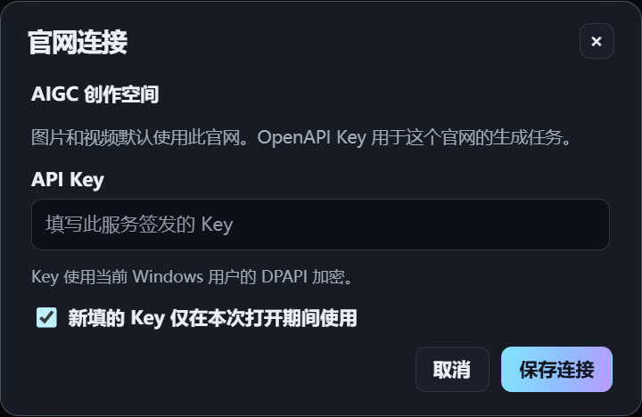

## 2. 粘贴分镜，给各镜保留独立草稿

进入 **剧本 → 手写或粘贴分镜**，填写剧本标题。在「粘贴分镜」中按镜号分段，写下画面、图片提示词和视频提示词。点 **保存剧本**。需要增删或调序时，再点 **编辑剧本**。

```text
镜头 1 灯塔初亮
画面：黎明时，海边的灯塔还亮着。
图片提示词：白色石灯塔，朱红灯室亮着暖光，前景是湿润的黑色礁石。
视频提示词：镜头缓缓前推，海浪拍上礁石后退去，薄雾向右移动。

镜头 2 退潮的礁石
画面：一束晨光落在退潮后的石缝。
```

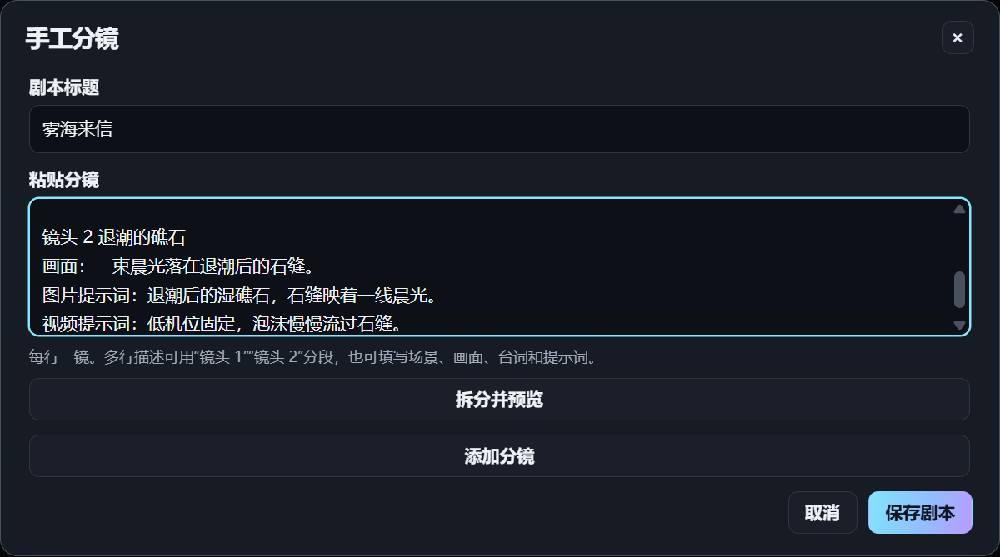

从某一镜点击 **用于生图** 或 **用于视频**，创作台会显示剧本名和镜号。实测先在第二镜留下“低机位看向两块黑色礁石之间的潮纹”的草稿，再回到第一镜生成。两个镜头各自保留提示词和素材。

## 3. 让两个模型画同一张图

使用 2.9.1 时，生成按钮上方会列出两侧实际提交的模型、画幅、分辨率、队列和预计费用。遇到第二个模板不支持的画幅，可在这里核对它将采用的值。

在第一镜点 **用于生图**。生成服务选 **AIGC 创作空间 · 官网**，主模板选 **GPT Image 2 · 文生图**，对比模型选官网 **Banana 2.1 · 生成与编辑**。本例两边均为 1K、9:16、普通队列。确认生成按钮上方显示两项任务以及两侧的预估价。

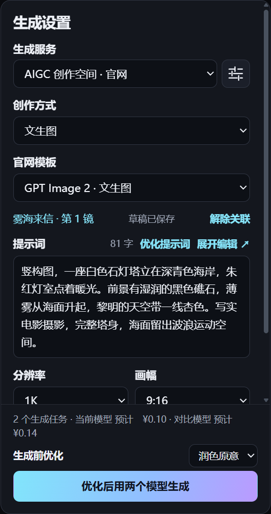

可直接点 **用两个模型生成**。若希望先改稿，在「生成前优化」选 **润色原意** 或 **丰富细节**。文本优化使用 **设置 → 剧本模型** 里的独立连接。已配置时可以编辑右侧优化稿后采用。本次只使用官网媒体 Key，在对照窗点 **用原文生成**，两个图片模型均收到了同一份原文。此处没有调用外部文本模型。

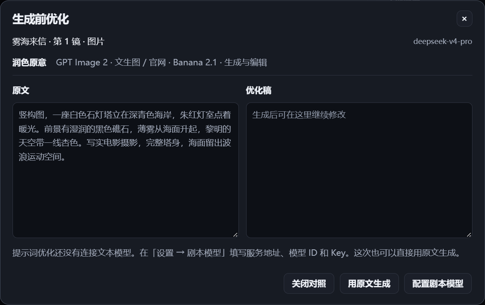

## 4. 并排选图，把定稿带入视频

候选图陆续返回后，在「双模型对比」中比较主体位置、光线和可运动的区域。点击选中一侧的 **选为定稿**。本例选左边的 GPT Image 2，灯室的暖光清楚，近处礁石和浪线适合下一步做缓慢前推的镜头。右侧图片也保存在作品库。

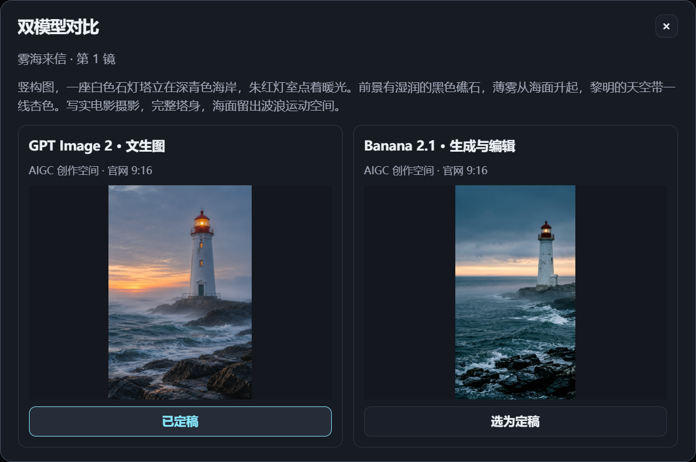

回到 **剧本 → 第一镜 → 用定稿图生视频**。创作台会放入选中的图片，并带上该镜的视频提示词。回到本镜的「双模型对比 1」可以再次查看选择。

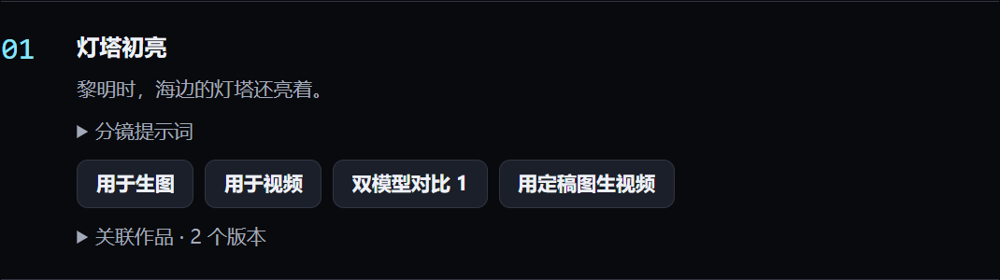

## 5. 检查首帧和运镜，生成视频

确认当前是 **视频**，所用模板为 **Seedance 2.0 Mini**，创作方式为 **图生视频 · 首帧**。查看「首帧图片」的缩略图和数量 **1/1**，并检查顶部镜号。本例选择 **4 秒、480p、9:16、普通队列**，关闭「生成音频」，预估 **¥0.92**。

本次视频提示词写的是“沿用首帧的白色灯塔、朱红灯室与海岸构图。镜头轻缓向前推，海浪拍上前景礁石后退去，薄雾缓慢向右移动，灯室的暖光保持稳定。” 确认后点一次 **生成视频**。

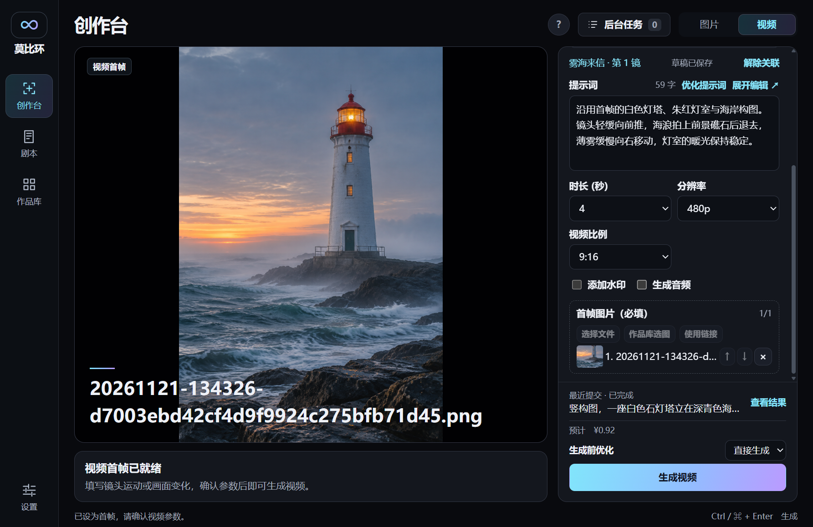

右上角打开 **后台任务 → 进行中 → 查看进度**。已有服务商任务号时，应用会查询原任务。可以切到其他镜头继续创作。

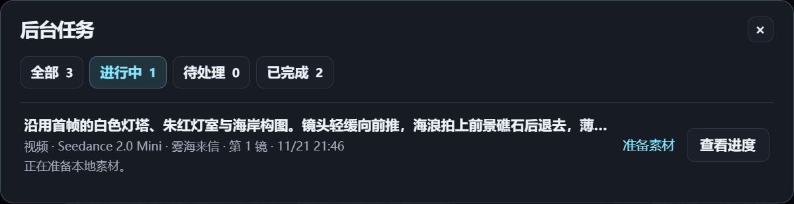

## 6. 播放、定稿和导出

在 **剧本 → 第一镜 → 关联作品** 打开已完成的视频，点播放检查主体、运镜和结尾。返回版本列表，点视频一行的 **设为定稿**。图片和视频各有一个定稿位置。

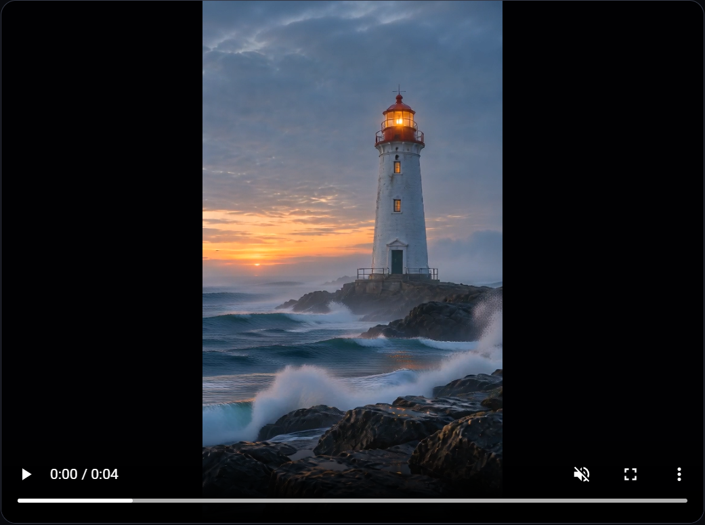

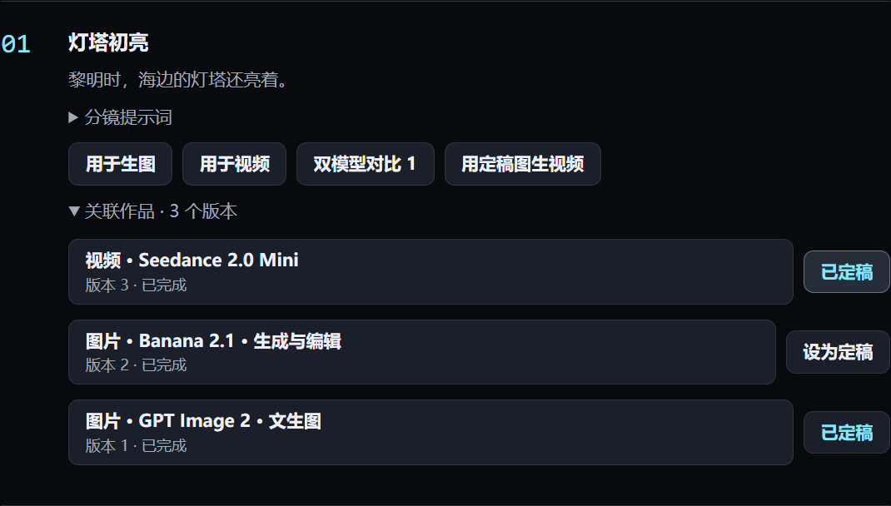

双击 **作品库** 中的卡片进入详情，使用 **另存原文件** 选择保存位置。需要统一图片交付尺寸时，可用 **按尺寸导出** 生成裁切或补边副本。**设置 → 文件与工具 → 打开作品目录** 可以找到本地原件。

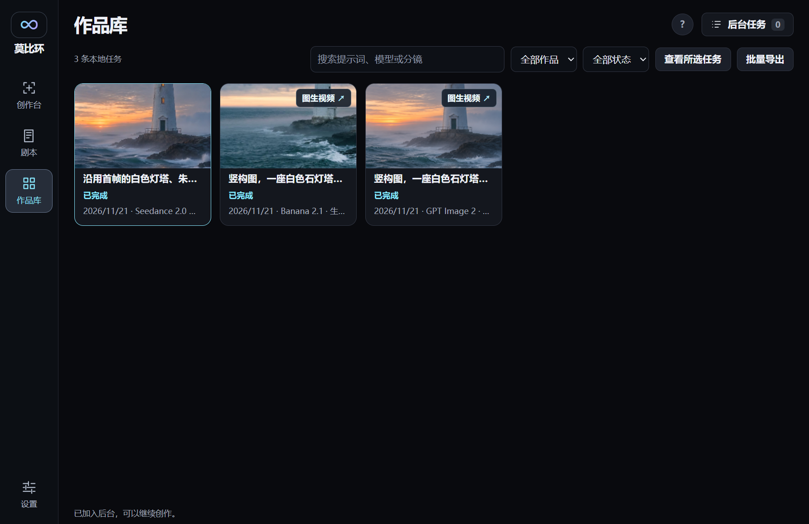

**本次交付检查。** 两个模型都请求了 9:16。GPT Image 2 实际返回 1024 × 1536，即 2:3。视频文件总时长为 4.096 秒，其中画面流为 4.042 秒。提交配置中「生成音频」为关闭，返回文件仍含有声的双声道 AAC 音轨。交付前应核对实际尺寸和音轨。三份导出文件与下载原件的 SHA-256 均一致。

**用 2.9.1 导出交付副本**

打开第一镜的定稿图，点「按尺寸导出」。应用按请求的 9:16 填入 864 × 1536。居中裁切会从原图左右取舍画面，选「完整保留画面」则可预览黑边。

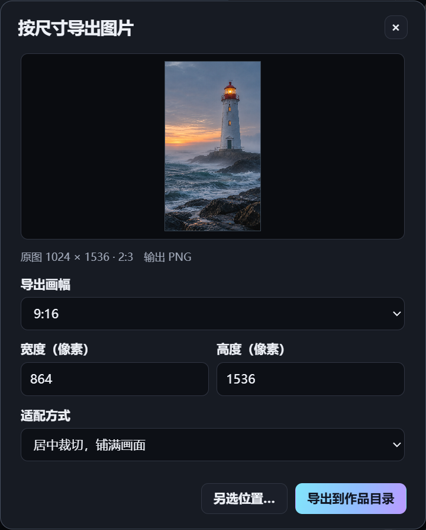

打开视频详情，核对「关闭生成音频」和实际的 1 条音轨，点「导出无音轨副本」。新 MP4 保留了原来 97 帧画面，移除了 AAC 音轨。两个副本都在作品目录的「导出」文件夹里。

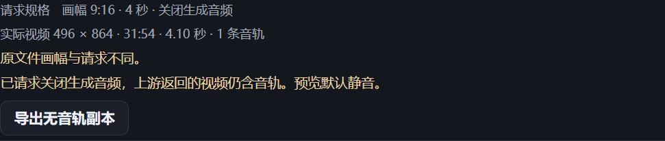

## 7. 关闭后继续做

正常关闭应用，再启动。在 **剧本** 打开《雾海来信》。第一镜的「双模型对比」能看到原来的图片定稿，「关联作品」中保留视频定稿。点 **用于视频** 可以继续改原来的运镜文字、首帧和 4 秒设置。第二镜点 **用于生图**，会恢复单独保存的草稿。

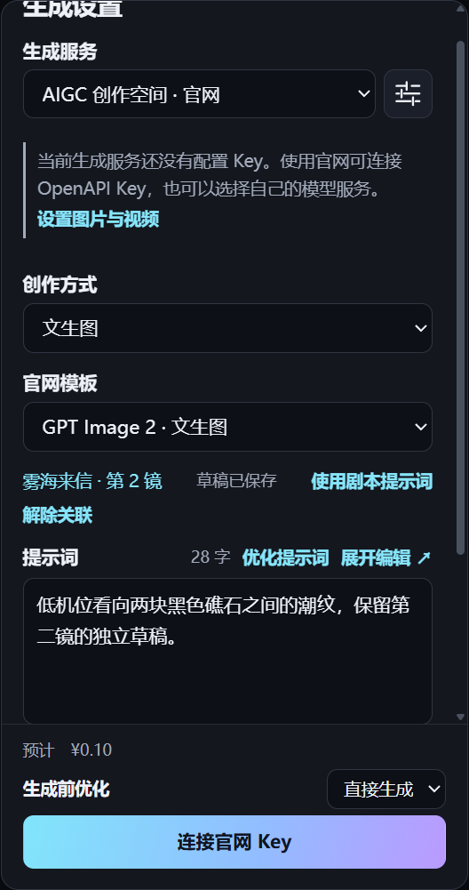

本次重启后仍是两张图片和一段视频，共 **3 项**，任务标识与重启前一致。视频用到的首帧文件与选中的 GPT Image 2 原图字节一致。临时 Key 已随实测进程退出释放。

## 8. 等很久或报错时

| 看到的情况 | 下一步 |
| --- | --- |
| 缺少 Key、模型不存在或权限不足 | 从提示打开对应连接，核对服务根地址、Key 所属账户、模型 ID 和访问权限。文本优化暂时未配置时可点「用原文生成」。 |
| 图片 2 分钟、视频 5 分钟没有新进度 | 打开任务详情看当前阶段与上次状态变化。已有编号时可继续等原任务。查询遇到限流会显示倒计时。 |
| 提交超时，状态为「提交待核实」 | 先按提交时间和模型到服务商核对记录，确认未受理再生成，避免重复付费。 |
| 查询或下载中断 | 在「后台任务 → 待处理 → 查看详情」点「继续查询原任务」或「重新下载结果」。要找服务商协助时，可复制排查信息。 |
| 服务商明确报告失败 | 查看处理建议和技术详情，回创作台复用参数，修正后再新建任务。 |

右上角 **? → 使用帮助** 可以随时查这些操作。下图是本次桌面实测打开的帮助页，三个官网任务均已完成。

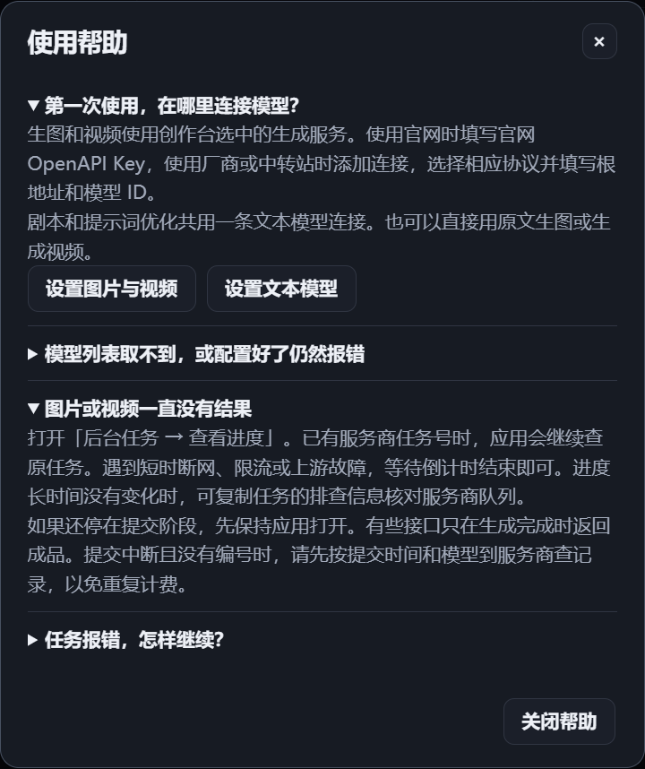
